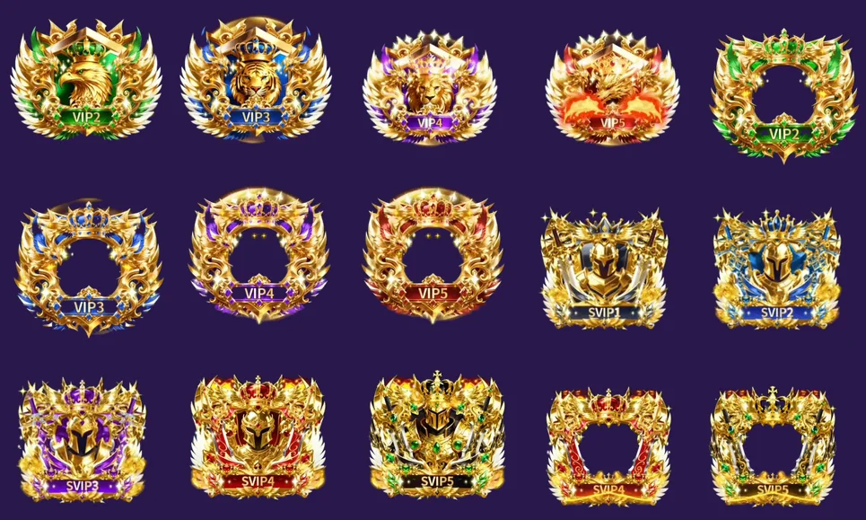

# VIP/SVIP ornaments from 18316.mp4



This 40.75-second source is a showcase video, not a standalone transparent
effect. The black letterbox bars and navy dotted background were removed, and
the individual designs were cut into **15 transparent, looping WebP files**.

| New items | Count | App placement |
| --- | ---: | --- |
| VIP 2–5 Royal Badges | 4 | Medal/badge choice, profile and room |
| SVIP 1–5 Royal Badges | 5 | Medal/badge choice, profile and room |
| VIP 2–5 Royal Frames | 4 | Avatar frame in profile and room seats |
| SVIP 4–5 Royal Frames | 2 | Avatar frame in profile and room seats |

The source does **not** contain a separate clearly labelled Noble ornament.
The previously bundled `noble-gold-microphone.webp` is unchanged.

Every new item is registered in the Android cosmetics selector, the Super Admin
catalogue and the D1 catalogue migration `0063_royal_vip_svip_clip_catalog.sql`.
Existing SVIP 1–8 auto-grants stay as they were. All 15 new catalogue rows start
inactive with placeholder coin prices; Super Admin can explicitly configure a
price or grant one to a verified user. No account roles, VIP expiry, entitlements,
balances or transaction records are migrated or changed.

To regenerate from the original attachment (requires `ffmpeg`, `numpy`, `scipy`):

```sh
python3 scripts/build_vip_svip_clip_assets.py /path/to/18316.mp4
```

Verify with `cd cloudflare && npm test` and inspect the generated WebP alpha
channels, playback and foreground fit on a real Android staging build.
This change is **not** a Play Store release or a live Cloudflare deployment.
